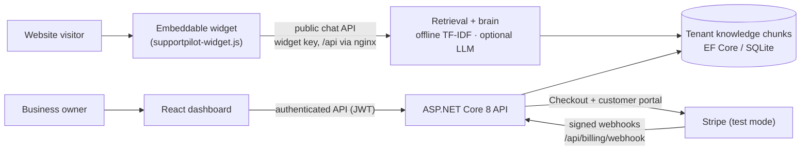

# SupportPilot AI — your support inbox, answered while you sleep

[](https://github.com/varunkonnojutech-lab/supportpilot-ai/actions/workflows/ci.yml)
[](LICENSE)
[](https://dotnet.microsoft.com/)
[](https://react.dev/)
[](https://codespaces.new/varunkonnojutech-lab/supportpilot-ai)

**An AI support agent for small businesses: train it on your own docs in minutes, drop one script tag on your website, and it answers customer questions 24/7 — with sources.**

No keys, no cloud account, no setup wizard from hell: clone it, run one Docker command, and chat with the seeded demo business in your browser.

```bash
docker compose up --build
# Landing + dashboard:  http://localhost:3000
# Live demo store:      http://localhost:3000/demo.html
```

Demo login: `demo@acmeoutdoors.com` / `Demo123!` — demo business **Acme Outdoors**, widget key `sp_demo_acme`.

## Who it's for

- **Small businesses and indie shops** whose owner is also the support team, answering "do you ship to Canada?" for the fortieth time.
- **SaaS founders** drowning in repeat questions that are already answered in their own help docs.
- **Anyone who wants a support bot that only says what their docs say** — every answer carries its sources, so customers (and you) can check it.

## Features

- **Train it on your own content** — paste docs, add Q&A pairs, or upload text; content is chunked and indexed per business.
- **Answers with sources** — replies cite the knowledge chunks they came from instead of asking you to trust a black box.
- **A brain that works with zero keys** — the built-in **offline provider** runs TF-IDF retrieval over your chunks and composes extractive, cited answers. It is honest retrieval, not an LLM: it won't invent policies you never wrote, and it needs no API key and no internet.
- **Optional OpenAI-compatible provider** — flip one env var and the same product uses a real LLM + embeddings endpoint (OpenAI or anything API-compatible) for more fluent answers.
- **Embeddable widget** — one `<script>` tag puts a chat bubble on any website (see [Embed the widget](#embed-the-widget)).
- **Conversation history + feedback** — every chat is stored per tenant; thumbs up/down feedback shows you which answers to improve.
- **Multi-tenant with plan quotas** — each business gets isolated data and its own widget key; Free / Starter / Pro plans cap documents and monthly chats.
- **Stripe billing (test mode)** — Checkout + signature-verified webhooks move a business between plans. No keys configured = billing disabled gracefully, everything else works.

## Architecture



- **Public chat path:** the widget identifies a tenant by its widget key — never by anything the visitor can change — and only ever retrieves that tenant's chunks.
- **Dashboard path:** owners log in (JWT), manage knowledge, read conversations, and see plan usage.
- **Billing path:** plans change only when Stripe's signed webhook says so, never because a browser came back from Checkout.

## Quick start

### Docker (recommended)

```bash
git clone https://github.com/varunkonnojutech-lab/supportpilot-ai
cd supportpilot-ai
docker compose up --build
```

Then open:

| URL | What you get |
|---|---|
| http://localhost:3000 | Landing page + dashboard. Log in with `demo@acmeoutdoors.com` / `Demo123!` |
| http://localhost:3000/demo.html | A fake store page for **Acme Outdoors** with the real widget embedded — chat with it, no keys, no sign-up |
| http://localhost:8080 | The API directly (Swagger in Development) |

First run creates the SQLite database (`supportpilot.db`) on a Docker volume and seeds the demo business, its knowledge, and the three plans.

### Run without Docker

```bash
dotnet run --project src/SupportPilot.Api    # http://localhost:8080
cd web && npm install && npm run dev          # http://localhost:5173 (Vite), proxies /api to the API
```

### Codespaces

Click the Codespaces badge above — the devcontainer installs the .NET 8 SDK and Node 20, forwards ports 8080 and 3000, and restores everything.

## Embed the widget

Add one script tag to any page on your site:

```html
<script src="https://your-domain/widget/supportpilot-widget.js" data-widget-key="YOUR_KEY" async></script>
```

Replace `https://your-domain` with where SupportPilot is hosted and `YOUR_KEY` with your business's widget key — find it in the dashboard under **Widget settings**. That's the whole integration: no build step, no framework, no other code. The widget talks to `/api` on the same origin it was loaded from.

## AI provider configuration

| | Offline (default) | OpenAI-compatible |
|---|---|---|
| Env vars | none — `Ai__Provider=offline` is the default | `Ai__Provider=openai` + `OpenAi__ApiKey` |
| How answers are made | TF-IDF retrieval over your chunks + extractive answers quoted from them | LLM chat completion, grounded on the retrieved chunks |
| Embeddings | none needed (term-frequency index) | `OpenAi__EmbeddingModel` (default `text-embedding-3-small`) |
| Chat model | — | `OpenAi__ChatModel` (default `gpt-4o-mini`) |
| Endpoint | — | `OpenAi__BaseUrl` (default `https://api.openai.com/v1`) — point it at any compatible provider |
| Cost / keys | $0, works fully offline | pay your provider per token |

Set these in a `.env` file (copy `.env.example`) before `docker compose up --build`. Plain talk: offline mode is great for FAQs and policy pages because it can only repeat what you wrote; the LLM mode reads better on messy, multi-part questions but can phrase things more freely — the source citations are there in both modes so you can spot-check.

## Plans

| Plan | Price | Documents | Chats / month |
|---|---|---|---|
| Free | $0 | 3 | 100 |
| Starter | $29/mo | 50 | 2,000 |
| Pro | $99/mo | 500 | 20,000 |

Quotas are enforced per tenant by the API. Billing runs through Stripe in test mode: add `Stripe__SecretKey`, `Stripe__PublishableKey`, and `Stripe__WebhookSecret` (see `.env.example`) and upgrades work end to end with the test card `4242 4242 4242 4242`. With no Stripe keys, the billing endpoints report "not configured" and the rest of the product is unaffected. Going live is covered in [docs/deploy.md](docs/deploy.md).

## Project layout

```
SupportPilot.sln
src/SupportPilot.Api/        ASP.NET Core 8 API — auth (JWT), tenants, knowledge,
                             public chat, retrieval/brain, Stripe billing, seeding
tests/SupportPilot.Tests/    Backend tests (tenant isolation, retrieval, quotas)
web/                         React 18 + TypeScript + Vite app
  src/                       Landing page + owner dashboard
  public/widget/             supportpilot-widget.js — the embeddable widget
  public/demo.html           Demo store page (Acme Outdoors) with the widget embedded
  Dockerfile, nginx.conf     node build → nginx; /api proxied to the API container
docker-compose.yml           api (8080) + web (3000), SQLite on a named volume
docs/deploy.md               Production deployment guide
```

## Roadmap

**v1.1 ideas** (not built yet — issues and PRs welcome):

- More file types for training: PDF and CSV uploads (v1 takes pasted text and plain-text uploads)
- Human handoff: route a chat to the owner's email/inbox when the bot's confidence is low
- Analytics: top unanswered questions, busiest hours, deflection rate
- More widget languages and themes

## Contributing

Pull requests are welcome — keep them small, include tests for backend changes (`dotnet test`), and make sure `npm run build` in `web/` stays green. CI runs both on every push and PR.

## License

MIT — see [LICENSE](LICENSE). Copyright (c) 2026 Varun Kumar Konnoju.
